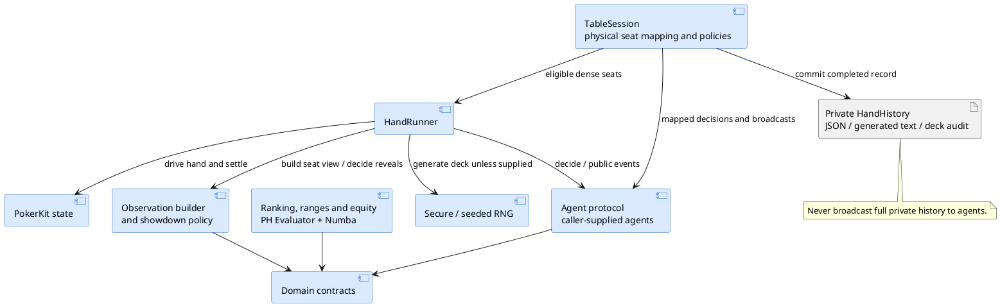
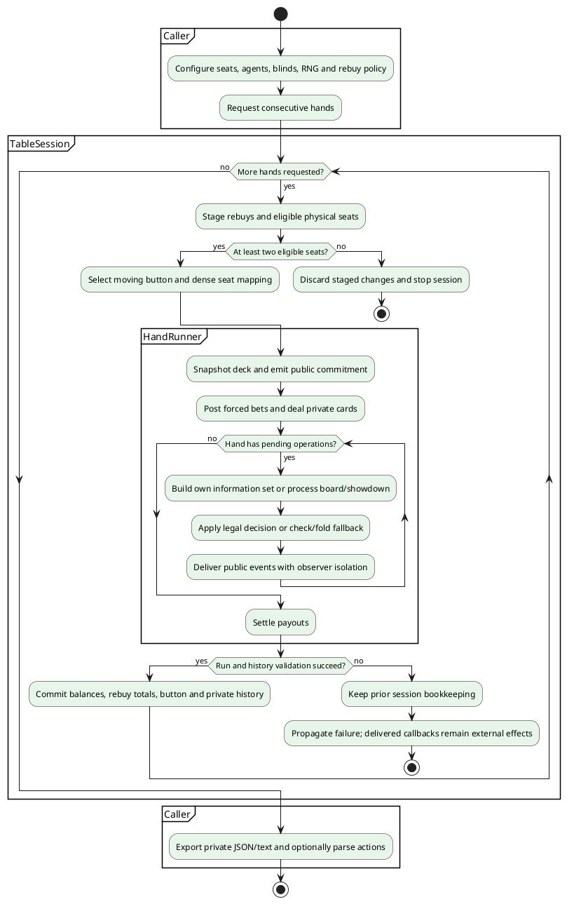

# Epic 1 Retrospective — Foundation & Game Engine

## 1. Executive summary

All seven stories are marked done. The epic delivered a typed, tested No-Limit Hold'em foundation: single-hand execution, information-set observations, explicit showdown rules, secure and seeded shuffles, deck commitments, hand ranking and heads-up equity, and synchronous multi-hand sessions with private histories.

This is an internal engine foundation, not a complete playable product. The frontend is a scaffold and the API exposes health infrastructure; simulation agents, arena reporting, real-time table APIs and gameplay UI remain later work. Epic 2 was not started during this documentation run.

The latest recorded validation, from story 1.7, is **362 backend tests passed, one slow test deselected, 100% source coverage**, plus Ruff, formatting checks on affected files, and strict mypy across 32 source files. These are implementation-session results, not checks rerun for this retrospective. Coverage measures exercised source lines; it does not establish absence of defects or operational readiness.

## 2. Delivered scope

### Story 1.1 — Monorepo scaffold and tooling

- Established the uv-managed backend, FastAPI health endpoint, package structure and CLI stub.
- Established the React/TypeScript/Vite frontend, component testing, linting and build configuration.
- Added CI, pre-commit and Docker configuration; local health/proxy checks passed, but Docker Compose itself was not executed because Docker was unavailable.

### Story 1.2 — Domain models

- Added immutable, validated cards, actions, observations and discriminated public events, plus the Agent protocol.
- Established string card serialization, JSON round-trips and property-based validation tests.
- Separated reusable contracts into `pokerbot.domain`; documented strict chip inputs and street-total action semantics.

### Story 1.3 — Single-hand execution

- Wrapped PokerKit for 2–9 players, forced bets, all-ins, side pots, split pots and net payouts.
- Contained invalid decisions and agent exceptions with check/fold fallback and recorded diagnostics; isolated observer failures.
- Added golden and chip-conservation tests, including a recorded successful 10,000-hand slow run. The slow test is excluded from the default suite.

### Story 1.4 — Information sets and showdown rules

- Built observations locally from only the acting seat's hole cards and public state; rejected non-actors and incomplete dealing.
- Made show/muck policy explicit, including uncontested pots, all-in reveals, ties and side-pot eligibility.
- Added leak/reveal properties and JSON, Python-dump and live-object checks; strengthened the scanner to prevent vacuous success.

### Story 1.5 — RNG and audit trail

- Added secure play shuffles using SystemRandom and explicit seeded simulation shuffles using PCG64.
- Broadcast a SHA-256 commitment at hand start and retained the initial deck only in private completed-hand history.
- Tested byte-identical replay from seeded regeneration and saved decks; review added validation tying a reloaded audit to the original start commitment.

### Story 1.6 — Ranking and equity

- Added PH Evaluator ranking for 5–7 cards and range expansion into canonical weighted two-card combinations.
- Added Numba-accelerated heads-up equity with blocker removal, weighted selection, uniform runouts and half-share ties.
- Met recorded accuracy/performance targets; review added card-ID bounds checks before native calls, including validation-bypass inputs.

### Story 1.7 — Sessions and hand history

- Added stack carry-forward, stable physical seats, moving-button rotation, sitting out/in and explicit none/manual/auto rebuy policies.
- Broadcast each mapped public event once to all original agents; guarded session mutation and committed bookkeeping only after successful completion.
- Added complete private JSON histories and a documented generated PokerStars-style text subset whose parser restores the same action list; tested 20 randomized three-hand session configurations.

## 3. Delivered architecture

`TableSession` maps stable physical seats to the eligible dense player set required by `run_hand`. PokerKit remains responsible for betting rules and settlement. Observation construction and explicit showdown policy protect what agents receive. `HandHistory` preserves the dense result plus physical-seat context, and maps public events/actions for consumers.

Ranking/equity is a separate reusable package. It is available for future strategy agents; this epic did not deliver those agents or an integrated strategy pipeline.

## 4. Main journey

A caller supplies table configuration and one agent per physical seat. Each hand stages eligible stacks and rebuys, selects the button, and obtains a secure, seeded or supplied deck. The runner commits the deck hash before play, requests only active decisions and emits public events. On success the session carries balances forward and appends private history; failures leave committed session bookkeeping unchanged, although previously delivered agent callbacks cannot be undone.

The activity diagram summarizes successful execution and failure outcomes; it is not a promise that callbacks can be rolled back or that the session is safe for concurrent use.

## 5. What worked well

- Golden hands and property tests complemented each other: named rules cases caught settlement/reveal details, while randomized hands exercised combinations of stacks, antes, illegal actions and seats.
- Library behavior was verified rather than inferred. A PokerKit river all-in flag quirk led to explicit local reveal policy, evaluated once before mucking changes live statuses.
- Review findings were small and concrete: audit/start consistency, Python dump privacy checks and native card-ID bounds became regression tests.
- Clear boundaries kept later work out of the engine epic: domain contracts, synchronous sessions, public events and private histories each have a defined role.
- Reproducibility tests compare actual serialized results. Performance reporting separates compiled kernels from the public wrapper and discloses warmup and input preparation exclusions.

## 6. Risks, debts and limits

| Area | Evidence and practical limit | Follow-up |
|---|---|---|
| Container execution | Compose files were checked, but the local Docker runtime path was not executed in story 1.1. | Run the documented Compose startup/health checks on a Docker-capable environment before claiming container readiness. |
| Native evaluator ABI | Numba calls exported C functions from the pinned phevaluator 0.6 extension. First calls compile kernels. | Verify symbols, correctness and warm/cold timings when changing dependency versions or target platforms. |
| Replay portability | Seed replay depends on the locked environment; the saved deck is the durable replay input. | Preserve deck order and configuration in private history; avoid cross-version seed guarantees. |
| Privacy and audit | A full history reveals all deck cards. A SHA-256 commitment checks later deck consistency; it is not authenticated proof of fairness. | Keep full histories out of public state/API messages; carry this boundary into later persistence and API work. |
| Session policy | Moving button skips inactive seats. No dead-button/missed-blind accounting; session is serial. Failed hands cannot reverse agent-side effects. | Preserve documented policy or introduce a separately specified policy before changing behavior. |
| Text compatibility | Parser accepts the generated PokerBot v1 subset, not arbitrary PokerStars exports. | Extend grammar with fixtures before accepting external histories; retain JSON for full replay records. |
| Equity scope | Monte Carlo heads-up equity only; known board sizes 0/3/4/5. Specific suits change the AA-vs-KK result. | Specify future multiway support separately and keep suit assumptions explicit in calibration fixtures. |
| Tooling follow-up | Story 1.1 records a filtered Starlette/httpx deprecation and a macOS Python 3.14 hidden `.pth` workaround. | Revisit the client dependency separately; retain documented local import troubleshooting. |
| Delivery state | Implementation runs reported an untracked scaffold and story files. | Review and establish a committed baseline before treating a clean checkout or remote CI result as verified. |

## 7. Decisions and next steps

Retain PokerKit for game rules and PH Evaluator for ranking rather than duplicating either algorithm. Keep showdown policy explicit in the engine and make all observation filtering local and testable. Preserve immutable domain contracts and street-total bet/call semantics across later APIs.

Retain separate secure-play and seeded-simulation modes, with private saved-deck replay. Keep dense engine indexing inside a hand and physical indexing at session-facing boundaries. Use the existing synchronous session as a foundation; async orchestration, persistence and UI remain later epics.

The next planned implementation is **epic 2, story `2-1-baseline-agents`**, followed by arena execution, duplicate deals, reporting and ranking. This retrospective does not start that work or change its scope.

No global doc update needed: the retrospective introduces no new runtime behavior, security policy, operational capability or roadmap commitment beyond the existing story and backend documentation. The epic planning section receives only a delivered summary and a link here.

## 8. Retained actions

These are proposed follow-ups for the next relevant work, not claims of completed tasks or assigned personal commitments.

| Action | Suggested owner role | Trigger / acceptance evidence |
|---|---|---|
| Establish a reviewable committed foundation. | Maintainer | Before a release/remote CI claim: clean-checkout install and recorded CI results. |
| Execute container startup and health checks. | Maintainer / CI owner | Docker-capable environment: backend health and frontend proxy verified through Compose. |
| Preserve privacy and seat semantics in arena integration. | Epic 2 implementer | Baseline/arena tests consume filtered observations; per-seat statistics use physical mappings deliberately. |
| Keep native upgrade checks explicit. | Evaluation maintainer | Dependency/platform upgrade: evaluator fixtures, bounds tests, Python compatibility and disclosed benchmark results. |
| Carry the private-history boundary into APIs/persistence. | Epic 5 implementer | Public payload tests exclude full audit/deck and unrevealed hole cards. |
| Revisit the recorded TestClient deprecation. | Tooling maintainer | Separate dependency decision and focused health/API regression checks. |

## 9. Readiness assessment

**Intermediate for internal engine use.** Evidence supports typed engine integration, deterministic research runs and scripted session testing. It does not establish a playable service, enterprise operations or commercial readiness.

Recorded validation highlights:

- Final epic suite: 362 passed, one slow test deselected, 100% source coverage; Ruff and strict mypy passed. The 10k-hand slow property was recorded as passing during earlier engine stories, not rerun at epic completion.
- Evaluation compatibility: 83 evaluation tests passed in an isolated Python 3.12 environment before the final bounds-only patch; later default runs include the added bounds cases on Python 3.14.
- Final story 1.6 benchmark: 412,254 public batch seven-card evaluations/s including validation/encoding, versus the 200,000 target; 26,818,340 encoded evaluations/s. Machine: macOS 26.6.2 arm64, Python 3.14.6, NumPy 2.5.4, Numba 0.67.0, phevaluator 0.6.0. Warmup and input object preparation excluded.
- Accuracy: `AsAh` versus all six `KK` combos returned 0.82236 at 50,000 samples, seed 42, within the specified 0.819 ± 0.005 tolerance. This is a sampled calibration result, not an exact universal equity for every suit pairing.

Documentation validation for this run checks source links, all seven done statuses, retrospective tracking and both PlantUML block structures. Runtime tests, performance measurements, Docker execution, diagram rendering and competitor research were not repeated for this documentation-only change.
